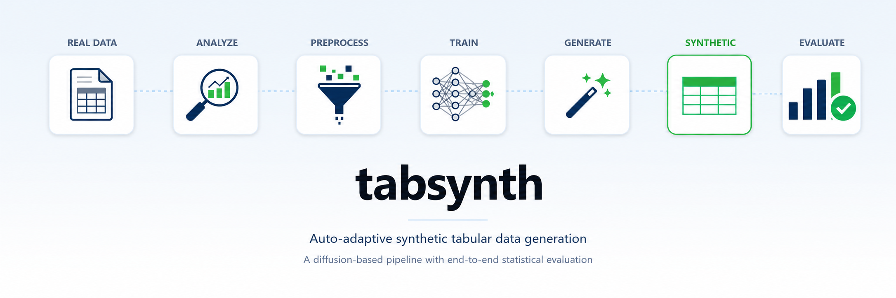
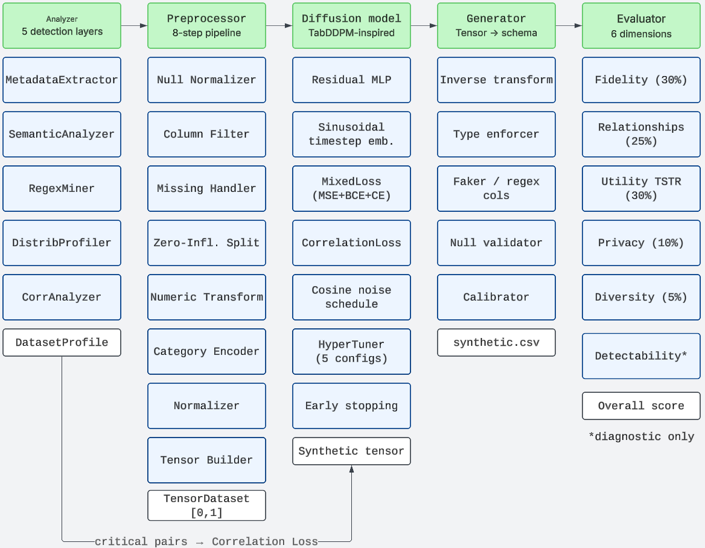

<p align="right">
  🌐 <strong>English</strong> · <a href="README.es.md">Español</a>
</p>

<div align="center">
  
</div>

<p align="center">
  <a href="#"></a>
  <a href="#"></a>
  <a href="#"></a>
  <a href="#"></a>
  <a href="#"></a>
  <a href="#"></a>
</p>

<p align="center">
  <b>Auto-adaptive synthetic tabular data generation via diffusion models.</b><br>
  Give it any CSV. It figures out the rest.
</p>

<p align="center">
  <a href="#statement-of-the-problem">Statement of the problem</a> ·
  <a href="#-the-data-never-leaves">Security</a> ·
  <a href="#getting-started">Getting started</a> ·
  <a href="#how-it-works">How it works</a> ·
  <a href="#results">Results</a> ·
  <a href="#architecture">Architecture</a> ·
  <a href="#limitations">Limitations</a>
</p>

---

## Statement of the problem

There's a problem that comes up constantly in data projects: you have valuable information, but you can't share it. Patient records can't leave the hospital. Financial data can't go to an external vendor. The ML team needs data to train models, but the real data is locked down by GDPR, by contract, or by plain common sense.

The usual answer is "just generate synthetic data." Easy to say. Hard to do well.

Most existing tools have the same flaw: someone has to configure the schema by hand, column by column. Specify what's a name, what's a category, what transformation to apply. And even then, the result tends to be data that looks fine at a glance but falls apart as soon as you put it through a model, because the correlations got lost, the distributions don't match, or nobody noticed that column had 70% zeros.

**tabsynth** starts from a different premise: the system has to understand the data before generating anything. Not you. The system.

A five-phase pipeline analyzes every column autonomously: its type, its statistical shape, its dependencies with other columns. With that understanding it configures and trains a diffusion model that doesn't just replicate each column independently, but the full joint distribution, relationships between variables included.

Three things that set it apart:

- **Zero configuration.** Drop the CSV, run, get synthetic data. The system automatically detects zero-inflated distributions, identifies GDPR direct identifiers, extracts patterns from structured fields, and picks the right numerical transform for each column. All on its own.
- **Correlations are preserved actively.** Strong dependencies between columns don't just get hoped into existence during training. They're explicitly injected into the loss function. If two variables are strongly related in the real data, the model is penalized for breaking that relationship.
- **Personal data is never used.** Names, emails, direct IDs: generated from scratch with Faker. The real values in those columns are discarded before training begins. That's not a configuration option. That's how the system works.

---

## 🔒 The data never leaves

This deserves its own section because it's the most important thing.

In many contexts (healthcare, banking, HR), the mere fact that data leaves the environment is already a legal problem. **tabsynth is built so that never happens**, not as a configurable policy, but as a consequence of how it's put together.

What does that mean in practice?

The only external service involved is GPT-4, and only to semantically classify ambiguous text columns, that is, to decide whether a column contains names, emails, or structured codes. But GPT-4 **never sees the actual values**. It receives only aggregated structural metrics: average string length, capitalisation ratio, whether it contains numbers, cardinality ranges. Nothing else. The real values don't go anywhere.

Everything else (distribution analysis, correlation computation, pattern extraction for code fields, model training, generation, evaluation) runs completely locally. No external calls, no data logs, no transfers.

And when the system finishes, the columns with direct personal identifiers (names, IDs, emails) are not in the diffusion model's output. They're generated separately with Faker, using the locale inferred automatically during analysis. The model never learned from those values because it never saw them.

What leaves the system is the synthetic dataset. And that dataset, by how it was built, can't be linked back to any real individual. This is also measured with the Distance Ratio metric, which confirms that synthetic records are further from real records than real records are from each other.

---

## Getting started

```bash
git clone https://github.com/LarenHernandezCalderon/synthetic-data-engine.git
cd synthetic-data-engine
pip install -r requirements.txt
cp .env.example .env   # add your OPENAI_API_KEY
```

Edit `src/main.py` and change the dataset:

```python
DATASET = "titanic.csv"   # or "plane.csv", "housing.csv", your own CSV
```

Run:

```bash
cd src
python main.py
```

You get three files: `output/synthetic.csv` with the generated data, `output/evaluation_report.txt` with a detailed quality breakdown, and the trained model checkpoint under `models/`.

---

## How it works

The pipeline has five phases. Each one has a single responsibility and hands a typed contract to the next: `DatasetProfile` from Phase 1 to the preprocessor, `PreprocessorOutput` to the diffusion model.

<div align="center">
  
</div>

### Phase 1: The analyzer (5 layers)

Everything downstream depends on what gets detected here. If the analysis is good, the rest of the pipeline can do its job. If it fails, nothing compensates for it.

The first layer (**MetadataExtractor**) inspects each column without storing values. For text columns it builds a structural signal profile (average length, capitalisation ratio, whether it contains numbers, whether it has special characters) that describes the shape of the data without exposing its content.

When those signals aren't enough to determine a column's type, the second layer steps in (**SemanticAnalyzer**). It sends the aggregated metrics to GPT-4, which returns the semantic type (`full_name`, `email`, `code`, `free_text`…), the GDPR category, and the locale for generation. Never the actual values, only the signals.

If the column turns out to be a structured code field (ticket numbers, product references, IDs with a specific format), the **RegexMiner** layer takes over. It analyzes the patterns locally and synthesizes a regular expression. Only the pattern comes out. The values stay inside.

The distribution layer (**DistributionProfiler**) determines the statistical shape of each numeric column: exponential, bimodal, zero-inflated, how many outliers. With that, it recommends the right transformation before the column goes into the model.

And the correlation layer (**CorrelationAnalyzer**) computes pairwise dependencies across all column pairs: Pearson and Spearman for numeric pairs, Cramér's V for categoricals, η² for mixed. Pairs that exceed the strong correlation threshold (≥0.40) are stored and will be used later to penalize the model if it breaks them.

### Phase 2: The preprocessor (8 steps)

Turns the original DataFrame into a tensor ready for the diffusion model. Each step is independent and invertible:

| Step | What it does |
|------|-------------|
| 0. Null Normalizer | Detects masked nulls like `-1`, `999` or `N/A` and converts them to `NaN` |
| 1. Column Filter | Decides what goes to the tensor, what gets generated externally (Faker, regex), and what gets skipped |
| 2. Missing Handler | Creates binary `_missing` indicator flags and imputes with median or mode |
| 3. Zero-Inflated Split | Splits zero-heavy columns into `_flag` (has a value?) + `_value` (how much?) |
| 4. Numeric Transform | Applies log1p or QuantileTransformer based on Phase 1's recommendation |
| 5. Categorical Encoder | Ordinal and one-hot encoding, respecting category order |
| 6. Normalizer | Scales everything to [0, 1] with MinMax |
| 7. Tensor Builder | Builds the typed `TensorDataset` with per-feature metadata |

The full inverse transformation lives in `inverter.py`, which reconstructs the original DataFrame from the generated tensor.

### Phase 3: The diffusion model

A Gaussian diffusion model for mixed tabular data, inspired by [TabDDPM (Kotelnikov et al., 2022)](https://arxiv.org/abs/2209.15421) but with several meaningful differences.

The architecture is a residual MLP with sinusoidal timestep embeddings. Each block applies layer normalization, a linear projection, SiLU activation, dropout, and another projection, plus a skip connection. The timestep is projected into every block so the model knows where it is in the denoising process.

The loss function combines MSE for continuous features, BCE for binary, and CrossEntropy for categorical. On top of that sits the `CorrelationLoss`, a term that at every training step compares the correlation matrix of the generated batch against the target values recorded in Phase 1, and penalizes the model for drifting away:

```
total_loss = mixed_loss + corr_weight × correlation_loss
```

Before training, `HyperTuner` runs a quick search across five network configurations (50 probe epochs each) and picks the one with the best loss. The winner trains to convergence with early stopping.

| Candidate | Hidden layers | lr | batch |
|-----------|-------------|-----|-------|
| A: light and fast | [128, 128] | 1e-3 | 256 |
| B: balanced | [256, 256] | 1e-3 | 64 |
| C: deeper | [256, 256, 128] | 1e-3 | 64 |
| D: wide, low lr | [512, 256] | 5e-4 | 128 |
| E: deep and wide | [512, 512, 256] | 1e-3 | 64 |

### Phase 4: The generator

Starts from pure Gaussian noise and runs 1,000 reverse diffusion steps to get the synthetic tensor. Then it inverts all the preprocessor transforms and reconstructs the original schema:

- Ordinal columns are snapped to the nearest valid integer
- Direct identifier columns are generated with Faker, using the locale inferred in Phase 1
- Code fields are generated with the regular expression extracted by the RegexMiner
- Null rates are preserved per column from the real dataset
- A post-hoc calibration step corrects residual distributional drift in continuous columns

### Phase 5: The evaluator (6 dimensions)

Synthetic data quality is measured from six angles. Five of them contribute to the overall score:

| Dimension | How it's measured | Weight |
|-----------|--------|--------|
| Fidelity | KS test + Wasserstein distance + TVD | 30% |
| Relationships | Frobenius norm on correlation matrices + per-pair delta | 25% |
| Utility (TSTR) | Train on Synthetic, Test on Real (3 ML models) | 30% |
| Privacy | Distance Ratio based on nearest-neighbour distances | 10% |
| Diversity | Variance ratio + PCA spread + category coverage | 5% |

The sixth, **Detectability**, is diagnostic: an adversarial RandomForest tries to tell real records from synthetic ones. If it succeeds easily, something needs improving. It doesn't contribute to the overall score because externally generated columns (Faker, regex, sequential IDs) would inflate it artificially.

Direct identifier columns are dropped from all evaluators before any computation. No real value enters any classifier.

---

## Results

Three datasets, three very different challenges: Titanic, small and full of edge cases (personal data, missing values, heavy-tailed distributions, zero inflation); Plane Crashes, medium-sized with very strong physical correlations between continuous variables; and California Housing, a large geospatial dataset where almost everything is correlated with everything else.

| Dataset | Rows | Cols | Fidelity | Relationships | Utility | Privacy | Diversity | **Overall** |
|---------|------|------|----------|---------------|---------|---------|-----------|-------------|
| **Titanic** | 891 | 12 | 0.78 | 0.84 | 0.81 | 1.00 | 0.96 | **0.84** 🟡 |
| **Plane Crashes** | 2,709 | 8 | 0.80 | 0.98 | 1.00 | 1.00 | 0.98 | **0.93** 🟢 |
| **California Housing** | 20,640 | 10 | 0.97 | 0.97 | 0.99 | 1.00 | 0.98 | **0.98** 🟢 |

> 🟢 ≥ 0.85 production-ready · 🟡 ≥ 0.70 suitable for most use cases · 🟠 ≥ 0.55 use with caution

All results use `SEED = 12` and are fully reproducible.

**What these numbers actually mean:**

On Plane Crashes, three classifiers trained on synthetic data achieve exactly the same accuracy on real data as classifiers trained on real data from the start. Zero gap. On California Housing the mean difference is 0.1%. On Titanic, the hardest of the three, it's 1.9%, with only 891 rows, 20% missing values in key columns, and several personal data columns mixed in.

Correlations are preserved because the model is explicitly penalized for breaking them. On California Housing, 35 out of 36 critical pairs are preserved. On Plane Crashes, every critical pair within tolerance.

Privacy scores 1.00 across all three datasets. The Distance Ratio confirms that synthetic records are further from real records than real records are from each other. No re-identification risk detected in any case.

And the pattern is clear: the more data, the better the model learns. Titanic with 891 rows reaches 0.84. Housing with 20k rows reaches 0.98.

---

## Architecture

```
synthetic-data-engine/
├── src/
│   ├── main.py
│   │
│   ├── analyzer/                      # Phase 1: autonomous analysis
│   │   ├── metadata_extractor.py      # structural inspection, no values stored
│   │   ├── semantic_analyzer.py       # GPT-4 classifies by signals, not values
│   │   ├── regex_miner.py             # local pattern extraction for code columns
│   │   ├── distribution_profiler.py   # Shapiro-Wilk, skewness, transform recommendation
│   │   ├── correlation_analyzer.py    # Pearson / Spearman / Cramér's V / η²
│   │   └── dataset_analyzer.py        # orchestrator → DatasetProfile
│   │
│   ├── preprocessor/                  # Phase 2: 8 modular, invertible steps
│   │   ├── contracts.py
│   │   ├── preprocessor.py
│   │   ├── steps/
│   │   │   ├── step0_null_normalizer.py
│   │   │   ├── step1_column_filter.py
│   │   │   ├── step2_missing_handler.py
│   │   │   ├── step3_zero_inflated.py
│   │   │   ├── step4_numeric_transform.py
│   │   │   ├── step5_categorical_encoder.py
│   │   │   ├── step6_normalizer.py
│   │   │   └── step7_tensor_builder.py
│   │   └── inverter.py
│   │
│   ├── diffusion/                     # Phase 3: diffusion model
│   │   ├── tabddpm.py                 # architecture + training loop
│   │   ├── mlp.py                     # ResidualBlock + SinusoidalEmbedding
│   │   ├── noise_scheduler.py         # cosine schedule
│   │   ├── loss.py                    # MixedLoss + CorrelationLoss
│   │   └── tuner.py                   # hyperparameter search + early stopping
│   │
│   ├── generator/                     # Phase 4: tensor → original schema
│   │   ├── generator.py
│   │   ├── type_enforcer.py
│   │   ├── column_builder.py          # Faker + regex
│   │   ├── null_validator.py
│   │   └── calibrator.py
│   │
│   └── evaluator/                     # Phase 5: 6-dimension quality score
│       ├── evaluator.py
│       ├── fidelity.py
│       ├── relationships.py
│       ├── utility.py
│       ├── detectability.py
│       ├── privacy.py
│       ├── diversity.py
│       └── report.py
│
├── data/
├── output/
├── models/
├── requirements.txt
└── .env.example
```

---

## Tech stack

| Layer | Library |
|-------|---------|
| Deep learning | PyTorch 2.x |
| Data processing | pandas, numpy, scipy |
| ML evaluation | scikit-learn |
| Personal data generation | Faker |
| Semantic analysis | OpenAI API (GPT-4) |
| Statistical tests | scipy.stats (KS, Shapiro-Wilk, Wasserstein) |

---

## Limitations

No sugarcoating:

- Heavy-tailed distributions are still the hardest case. `log1p` helps a lot, but the extreme tail gets undersampled on small datasets. That's a data volume limitation, not a model one.
- High-cardinality categoricals with noisy real-world values degrade TVD scores. The model generates correctly formatted values but can't perfectly replicate a noisy real-world distribution.
- CPU training on large datasets can take between 20 and 60 minutes. GPU brings it down to around 5.
- Free-text columns aren't generated in this version. They're skipped and logged in the profile. NLP generation is on the roadmap.

Not supported yet: time-series data, multi-table relational schemas, or streaming input.

---

## Roadmap

- [ ] Interactive demo on Hugging Face Spaces
- [ ] Fix for low-cardinality ordinals (≤10 unique values → `transform=none`)
- [ ] Optional Microsoft Presidio integration for value-level PII validation
- [ ] NLP generation for free-text columns
- [ ] Time-series support
- [ ] Multi-table relational schemas

---

## Citation

If you use this in research or production:

```bibtex
@software{hernandez2026tabsynth,
  author  = {Hernández Calderón, Laren},
  title   = {tabsynth: Auto-adaptive synthetic tabular data generation via diffusion models},
  year    = {2026},
  url     = {https://github.com/LarenHernandezCalderon/synthetic-data-engine}
}
```

The architecture is inspired by TabDDPM, not a reimplementation of it:

> Kotelnikov, A., Baranchuk, D., Rubachev, I., & Babenko, A. (2022). *TabDDPM: Modelling Tabular Data with Diffusion Models*. ICML 2023.

Key differences: residual MLP with sinusoidal timestep embeddings, mixed Gaussian loss (MSE + BCE + CE) instead of the multinomial diffusion process for categoricals in the original paper. The five-layer analysis pipeline, the `CorrelationLoss`, and the six-dimension evaluation framework are original to this project.

---

## License

MIT. See [`LICENSE`](LICENSE).

---

## Author

**Laren Hernández Calderón**

[GitHub](https://github.com/LarenHernandezCalderon) · [LinkedIn](https://www.linkedin.com/in/laren-hern%C3%A1ndez-a9037a2a5/)

---

<sub>Built with care. If this helped you, a ⭐ on the repo means a lot.</sub>
